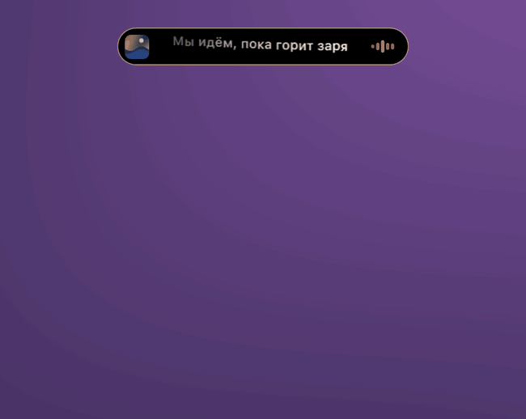
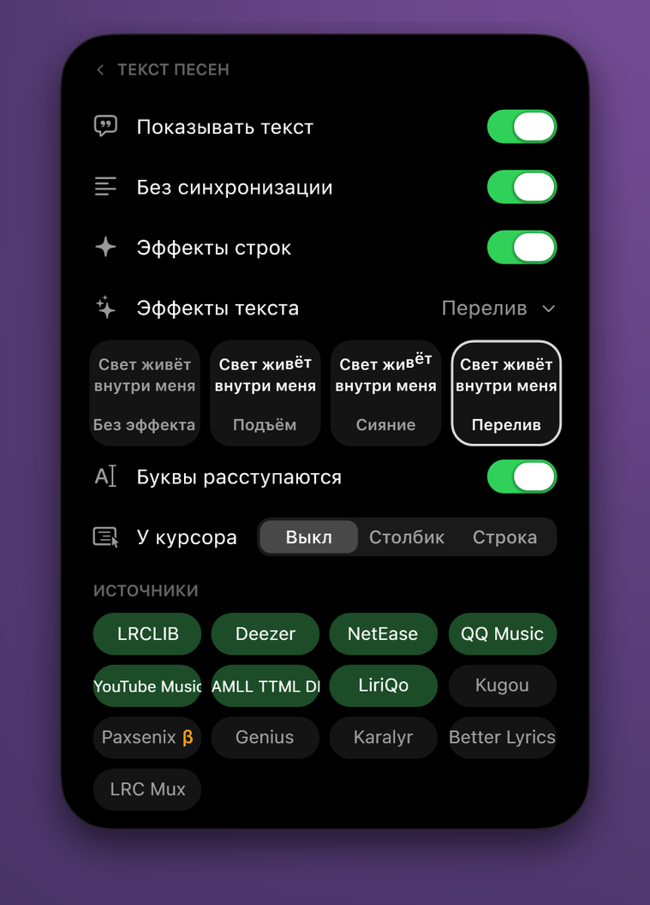

# Dynamic Island для Windows

Форк [DynamicIsland Михаила Котовского](https://github.com/mihailkotovski/DynamicIsland). Островок у верхнего края экрана объединяет плеер, тексты песен, часы, погоду и быстрые действия.

## Управление

- **Левый клик** раскрывает островок. Можно и потянуть его вниз. Если в режиме ожидания видна погода, клик по правой половине открывает прогноз.
- **Правый клик** открывает меню. Оттуда доступны настройки, оформление, таймер, полка, погода, QR с экрана и управление записью OBS.
- **Плеер** показывает активный медиасеанс Windows. Доступность перемотки зависит от того, что передаёт исходный плеер.
- **В полноэкранном приложении** подведи курсор к середине верхнего края основного экрана. Если включено «Скрывать на полном экране», островок временно появится. Для распознанных игр и эксклюзивного полноэкранного режима Direct3D наведение отключено.

[Раскрытие перетаскиванием](drag-demo.gif) · [Меню и настройки в движении](menu-demo.gif) · [Таймер рядом с плеером](timer-bubble.gif)

## Тексты песен

Островок подбирает текст к текущему треку. В разделе **«Настройки → Текст песен»** можно включить обычный текст без синхронизации, эффекты строк и текст у курсора. В плитках **«Эффекты текста»** две строки показывают анимацию по очереди.

## Настройки островка

В **«Мини-островке»** выбираются часы, минуты и секунды, день недели и режим отображения погоды. В **«Оформлении»** настраиваются размер, отступ, стекло, фон, эквалайзер и вид полосы прогресса.

[Галерея экранов и GIF](gallery.md)

## Скачать

Открой [последний релиз](https://github.com/shapezopm/DynamicIsland/releases/latest) и скачай DynamicIsland.exe из раздела Assets. Подходит для Windows 10 версии 2004 и новее и Windows 11, x64. Установка не нужна.

## Сетевые функции и ресурсы

Медиасеансы читаются через Windows. Включённый поиск текстов обращается к выбранным источникам с данными трека или ручным запросом. Для прогноза используются Open-Meteo и координаты выбранного места. OBS подключается по локальному WebSocket.

В сборке используются Unbounded (SIL OFL 1.1) и SF Pro.

## 3D-модели

Рендеры устройств подготовлены в Blender. Исходные модели — [CC BY 4.0](https://creativecommons.org/licenses/by/4.0/).

- вкладыши — [«AirPods (3ᵉ génération)»](https://sketchfab.com/3d-models/airpods-3e-generation-ed331e742ab944e683dcddd59ab0713e), автор [polyman](https://sketchfab.com/Polyman_3D); кейс убран;
- накладные — [«Airpods max sky blue»](https://sketchfab.com/3d-models/airpods-max-sky-blue-3d0643db08fc4ef89bda55a74077ece4), автор [polyman](https://sketchfab.com/ely.haddad); перекрашены в серебро;
- колонка — [«JBL Charge 3 speaker»](https://sketchfab.com/3d-models/jbl-charge-3-speaker-661f85fe3e4048f59785b2a75ffa52f8), автор [Aleksei Rozumnyi](https://sketchfab.com/Aleksei.Rozumnyi).

