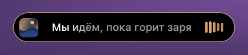
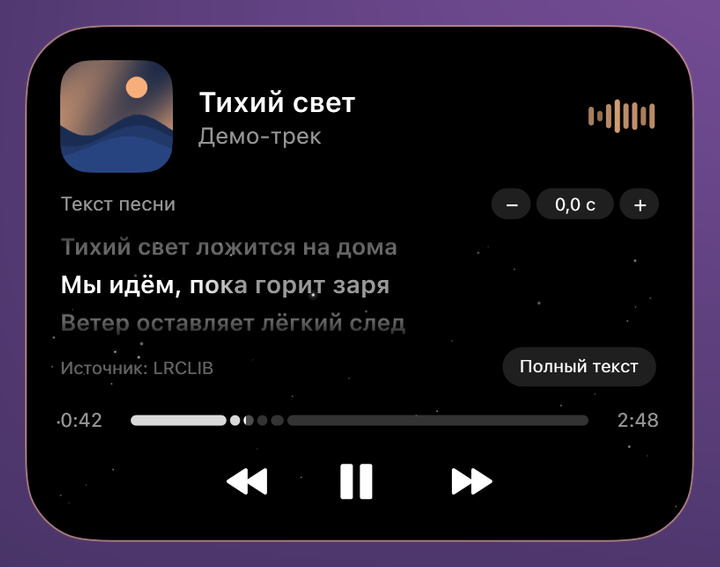
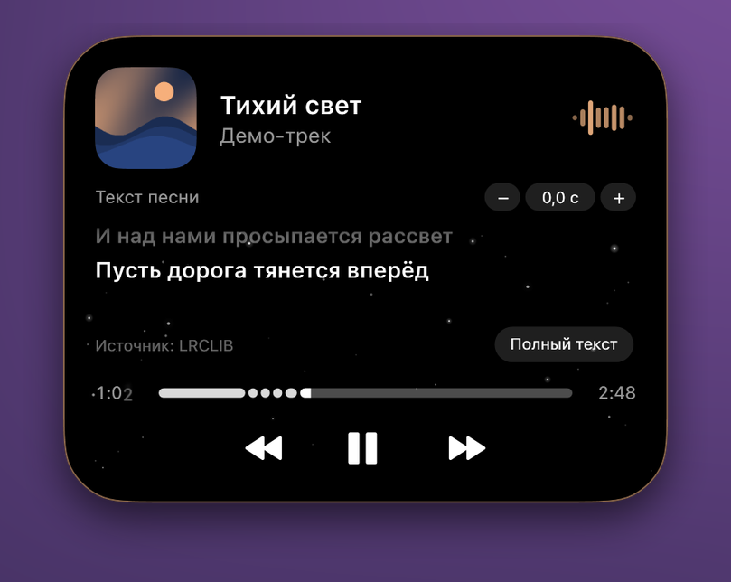
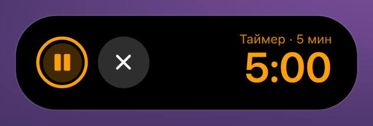
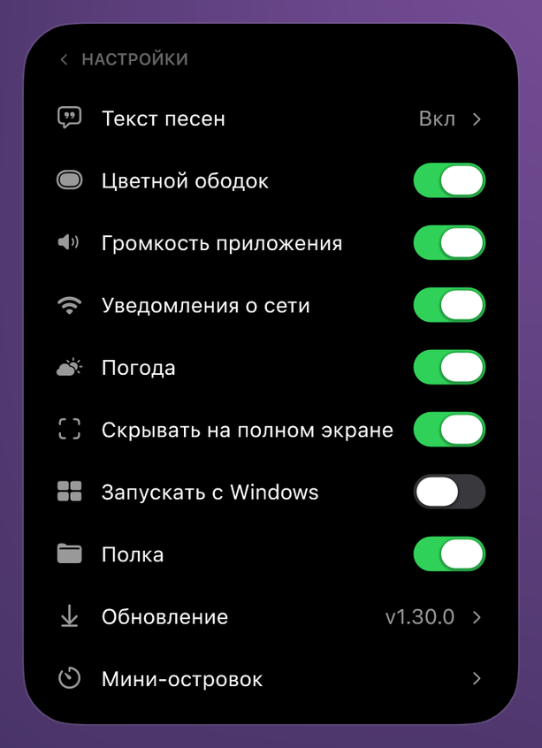
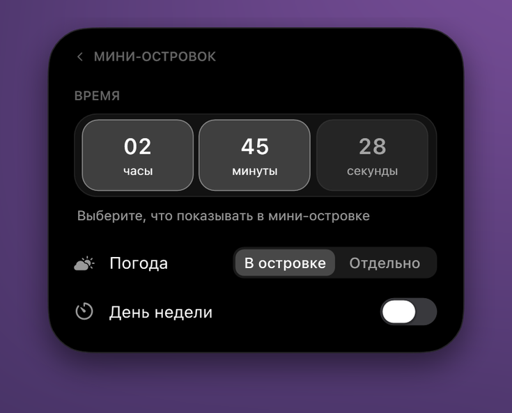

# Галерея DynamicIsland

Кадры отрисованы текущим интерфейсом Windows с демонстрационными данными. Названия треков, строки текста, обложка и файлы на полке сделаны для этих примеров; состояния зарядки и OBS заданы для съёмки.

## Островок в движении

| Раскрытие в плеер | Раскрытие перетаскиванием |
| --- | --- |
|  |  |

| Меню и настройки | Пузырь таймера |
| --- | --- |
|  |  |

## Экраны

| Экран | Снимок |
| --- | --- |
| Компактный плеер |  |
| Плеер с текстом |  |
| Стекло |  |
| Часы |  |
| Громкость |  |
| Зарядка |  |
| Таймер |  |
| Настройка таймера |  |
| Пузырьки |  |
| OBS |  |
| Полка |  |
| Меню |  |
| Настройки |  |
| Мини-островок |  |
| Оформление |  |
| Тексты песен |  |

